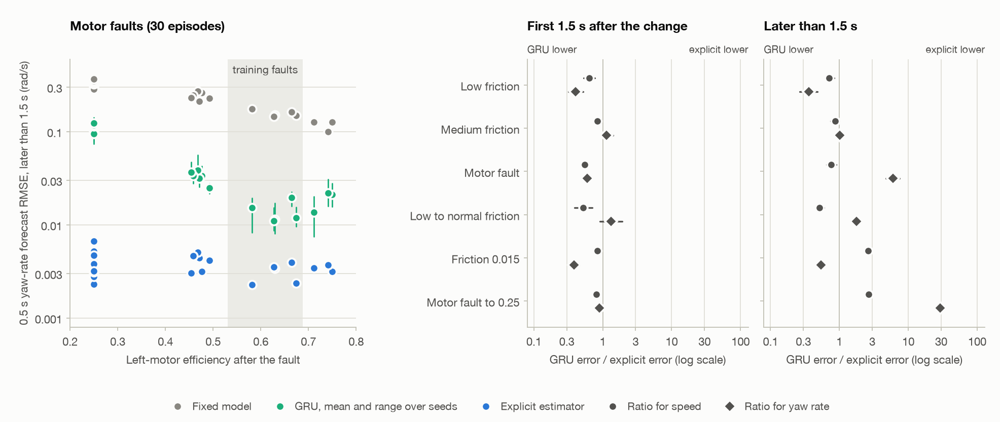

# 适应方式对照研究

本页路径相对于仓库根目录。命令示例从仓库根目录的 CMD 开始。依赖与学习阶段相同，见 `mujoco_learned_ready/requirements.txt`。

这个目录回答一个问题：动力学变化之后，显式参数估计和学习得到的潜在状态，各自在什么变化下失效。[复核对照](../followup_checks/README.md)用 24 个回合、一份权重给出了初步答案，这里按实验编号逐步把它做扎实。目前完成的是实验 0。

## 实验 0：把已有对照重做一遍

做三件事：让 GRU 训练到收敛并重复 8 个训练种子；每种物理条件新增 12 个没有人看过的留出回合；用按回合重抽样的区间报告差距。要检验的陈述来自复核对照的说明，写在这些新回合产生之前，判据在看到正式结果之前已写进 `exp0_evaluate.py`。

### 运行

```cmd
python adaptation_study\exp0_collect.py
python adaptation_study\exp0_train.py
python adaptation_study\exp0_evaluate.py
```

三步依次需要 MuJoCo、PyTorch、Matplotlib，输出写入 `adaptation_study\runs\exp0`。在一台四核笔记本上分别约 70 秒、3.5 分钟和十几秒。随仓库保存的参考输出在 `sample_results/exp0`，只装 NumPy 和 Matplotlib 也能从它重算评测：

```cmd
python adaptation_study\exp0_evaluate.py --data-dir adaptation_study\sample_results\exp0\data --training-dir adaptation_study\sample_results\exp0\training --output-dir runs\exp0_check
```

### 数据

`exp0_collect.py` 不渲染图像，只保存车体速度、角速度、轮速和指令，这是历史 GRU 和显式估计器用到的全部输入。

| 部分 | 回合数 | 来源 |
|---|---:|---|
| 训练、验证 | 48、12 | 按学习阶段原来的计划和随机种子重建 |
| 原有留出回合 | 24 | 同上，用于和已保存结果对接 |
| 新留出回合，测试 | 48 | 无变化、低摩擦、中等摩擦、电机故障各 12 个，采样方式与训练相同 |
| 新留出回合，分布外 | 36 | 低摩擦回到正常、摩擦 0.015、电机效率 0.25 各 12 个 |

没有相机时外观不起作用，所以报告按物理条件分组：只换外观的回合并入"无变化"，外观与摩擦相关、隐藏摩擦的回合按变化后的摩擦系数归入低摩擦或中等摩擦。

脚本在写出数据前先和仓库保存的学习阶段核对：名义模型标定结果相差不超过 2.6e-07，84 个原有回合的事件时刻完全相同，24 个原有留出回合里 23 个的真值相差小于 1e-4。剩下的 `ood_003` 从 8.2 秒起有最大 0.013 的出入，它处在低摩擦打滑状态，对数值差异敏感。

### 训练

`exp0_train.py` 原样使用 `learning.py` 的历史模型、损失、优化器、数据窗口和归一化，只改了三点：只训练历史模型；轮次上限从 40 提到 600，验证损失连续 50 轮没有改善就停止，保留验证损失最低的一轮；重复 8 个训练种子。

8 个种子都因不再改善而停止，最佳轮次在 100 到 142 之间。验证损失在第 40 轮平均为 0.343，最佳为 0.310。脚本同时重放学习阶段保存的权重作为参照，它在 23 个回合上的预测与保存值相差小于 1e-5。

### 结果



左图是 30 个电机故障回合在故障 1.5 秒之后的角速度预测误差，按故障后的电机效率排开。右边两图是新回合上 GRU 误差与显式估计器误差之比，1 表示相同，短线是 95% 区间。

**事先写下的陈述，在 84 个新回合上的检验。** 比值是 GRU 误差除以显式估计器误差，对回合取几何平均，GRU 先对 8 个种子取平均；区间是对回合重抽样的 95% 区间。

| 陈述 | 比值与区间 | 结论 |
|---|---:|---|
| 电机故障 1.5 秒之后，显式估计器的角速度误差更低 | 5.95 [4.75, 7.43] | 成立 |
| 电机效率降到 0.25 时，差距至少十倍 | 29.2 [24.3, 34.2] | 成立 |
| 电机故障后头 1.5 秒，GRU 的角速度误差更低 | 0.60 [0.50, 0.70] | 成立 |
| 低摩擦下，GRU 的速度误差更低 | 0.71 [0.62, 0.83] | 成立 |
| 摩擦 0.015 时，显式估计器稳定后的速度误差更低 | 2.62 [2.38, 2.91] | 成立 |
| 摩擦 0.015 时，GRU 稳定后的角速度误差更低 | 0.54 [0.46, 0.65] | 成立 |
| 没有变化时，显式估计器的角速度误差高于固定模型（显式比固定） | 1.55 [1.32, 1.80] | 成立 |
| 没有变化时，GRU 的角速度误差高于显式估计器 | 2.64 [2.32, 2.93] | 成立 |
| GRU 的潜在状态在效率 0.25 时贴近上下限，在测试集故障下不贴近 | 32% 对 16% | 不成立 |

**新回合上各条件的误差。** 每个回合的 0.5 秒预测 RMSE 再对回合取平均，速度（米/秒）/ 角速度（弧度/秒）；"无变化"用全部预测起点，其余用变化 1.5 秒之后的起点。

| 条件 | 固定模型 | 显式估计器 | GRU（8 个种子平均） |
|---|---:|---:|---:|
| 无变化 | 0.0074 / 0.0021 | 0.0085 / 0.0032 | 0.0044 / 0.0085 |
| 低摩擦 | 0.0312 / 0.0415 | 0.0163 / 0.0367 | 0.0113 / 0.0135 |
| 中等摩擦 | 0.0110 / 0.0112 | 0.0115 / 0.0122 | 0.0099 / 0.0122 |
| 电机故障 | 0.0407 / 0.1891 | 0.0089 / 0.0035 | 0.0072 / 0.0226 |
| 低摩擦回到正常 | 0.0075 / 0.0025 | 0.0095 / 0.0051 | 0.0050 / 0.0089 |
| 摩擦 0.015 | 0.1183 / 0.0567 | 0.0195 / 0.0293 | 0.0506 / 0.0151 |
| 电机效率 0.25 | 0.0711 / 0.3255 | 0.0101 / 0.0040 | 0.0265 / 0.1121 |

**电机故障按故障后的效率分段。** 故障 1.5 秒之后的角速度 RMSE（弧度/秒），新旧回合合计 30 个。训练集里的 6 个故障效率在 0.53 到 0.69 之间。

| 故障后的效率 | 回合数 | 固定模型 | 显式估计器 | GRU | GRU 比显式 |
|---|---:|---:|---:|---:|---:|
| 0.71–0.75 | 3 | 0.117 | 0.0034 | 0.0189 | 5.5 倍 |
| 0.58–0.68（训练故障的范围内） | 5 | 0.156 | 0.0031 | 0.0138 | 4.5 倍 |
| 0.45–0.50 | 6 | 0.241 | 0.0041 | 0.0332 | 8.1 倍 |
| 0.25 | 16 | 0.324 | 0.0036 | 0.1107 | 31 倍 |

### 和之前相比，哪些变了

- **方向没有变。** 八条关于误差的陈述在新回合上全部成立，区间都不跨过 1。
- **"潜在状态饱和"的解释站不住。** 学习阶段保存的那份权重在效率 0.25 时有 43%–48% 的潜在值贴近上下限，测试集故障下几乎为零。训练到收敛后，这个比例在 8 个种子之间从 12% 到 60% 不等，测试集故障下也有 16%；而每个种子在效率 0.25 时的误差都停在 0.07 以上。误差随着远离训练范围而升高是稳定的现象，但不能用潜在状态饱和来解释。
- **GRU 的误差在训练范围内最低，向两侧升高。** 即使在训练故障的范围内，它稳定后的角速度误差仍是显式估计器的 4.5 倍。训练集只有 6 个故障回合，这是数据不够还是表示本身的限制，要由实验 1b 回答。
- **训练到收敛只改善了同分布的结果。** 原有 12 个测试回合上，速度/角速度的合并 RMSE 从 0.0118 / 0.0200 变为 0.0097 / 0.0199；原有 12 个分布外回合上从 0.0239 / 0.0701 变为 0.0293 / 0.0673，种子之间在 0.0257–0.0359 / 0.0587–0.0733 的范围内。显式估计器在这两组上是 0.0160 / 0.0278 和 0.0251 / 0.0536。
- **没有变化时，收敛后的 GRU 速度误差低于固定模型**（比值 0.58，区间 [0.52, 0.66]），角速度误差则是固定模型的 4.1 倍（区间 [3.31, 4.98]）。之前那份 40 轮的权重在速度上与固定模型持平。
- **中等摩擦几乎不构成变化。** 摩擦系数 0.07–0.13 时三种预测器的误差接近，这一档对当前的指令幅度没有造成牵引力不足。

### 解释时要保留的限制

- 全部是仿真，且只比较了 0.5 秒的开环预测，不涉及闭环控制。
- 区间只反映留出回合的抽样；训练集是固定的 48 个回合，换一批训练回合结果会怎样没有测。种子之间的范围单独列在 `exp0_summary.json` 的 `range_across_seeds` 里。
- 显式估计器只用车体速度、角速度和名义指令，GRU 额外使用左右轮速。显式估计器的主结果用 0.8–3.2 秒自适应窗口，其余四组设置的结果在 `exp0_summary.json` 的 `sensitivity` 里；3.2 秒固定窗口在故障后 1.5 秒时还没有换完，角速度误差明显偏高。
- 本次运行的环境与仓库要求不同：MuJoCo 3.10.0（要求 3.16 及以上，这台 Intel Mac 上没有对应的安装包），训练用 Python 3.9 上的 PyTorch 2.2.2 和 NumPy 1.26.4。上面的两项核对说明差异没有影响到原有回合，但在 Windows 上重跑不保证逐位一致。

## 文件

| 文件 | 内容 |
|---|---|
| `study.py` | 三个步骤共用的路径、数据读取和重抽样区间 |
| `exp0_collect.py` | 不渲染图像的数据采集，以及与学习阶段的核对 |
| `exp0_train.py` | 多种子、训练到收敛的历史 GRU，并对留出回合做预测 |
| `exp0_evaluate.py` | 评分、按回合的统计、事先陈述的检验和汇总图 |
| `sample_results/exp0/` | 数据集、8 个种子的权重和预测、汇总 JSON 和图 |
