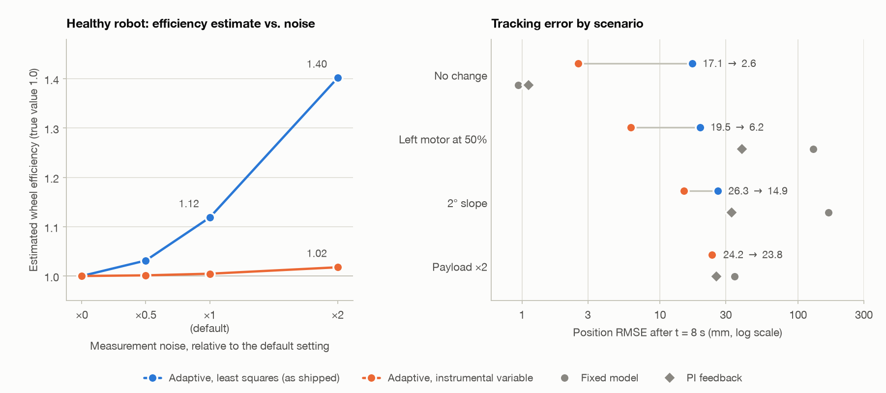
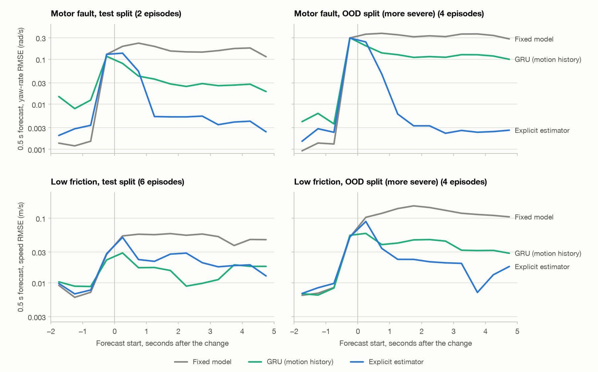

# 复核对照：闭环估计偏差，显式估计器与学习预测

本页路径相对于仓库根目录。命令示例从仓库根目录的 CMD 开始。依赖安装见[仓库说明](../README.md)；这里只需要 NumPy 和 Matplotlib，不需要 MuJoCo 或 PyTorch。

这个目录对已有阶段的结果做两项追加检查。它只读取 `simulation_ready` 和 `mujoco_learned_ready` 里的代码与已保存结果，不修改它们，也不重新训练任何模型。

| 检查 | 回答的问题 | 使用的数据 |
|---|---|---|
| [`closed_loop_bias.py`](closed_loop_bias.py) | 正常工况下自适应为什么更差，能否去掉 | 二维仿真 `simulation_ready/core.py`，现场运行 |
| [`explicit_vs_learned.py`](explicit_vs_learned.py) | 同一批留出日志上，显式两参数估计器和 GRU 谁更准，各在哪里失效 | `mujoco_learned_ready/results/trained/predictions` 中保存的 24 个回合 |

## 运行

```cmd
python followup_checks\closed_loop_bias.py
python followup_checks\explicit_vs_learned.py
```

第一条命令默认运行 10 个噪声种子，约需两分钟；`--seeds 3` 可以快速试跑，`--path circle` 换成圆形参考轨迹。第二条命令几秒完成。两者都把汇总 JSON 和结果图写入 `followup_checks\results`，可用 `--output-dir` 改到别处，用 `--no-plot` 跳过作图。随仓库保存的参考输出在 `sample_results`。

## 检查一：闭环下的效率估计偏差

### 现象与原因

`WheelEstimator` 用相邻两次速度观测反推车轮受力，再对同一步的指令做最小二乘。闭环时，第 t 步的指令由第 t 步的观测算出，反推的力又含有第 t 步观测的差分，两者带着同一份测量噪声。这部分噪声在窗口内不会被平均掉，估计值因此偏高，噪声越大偏得越多。

[`iv_estimator.py`](iv_estimator.py) 把回归量换成上一步的指令（工具变量）。上一步指令在第 t 步观测产生之前就已确定，与这份噪声无关；指令变化缓慢，它又与当前指令高度相关。窗口、报警、小输入保护和裁剪全部沿用原实现。

### 结果



正常工况、3.2 秒固定窗口、10 个种子，两轮效率估计的平均值（真值 1.0）：

| 测量噪声 | 最小二乘（现有） | 工具变量 |
|---|---:|---:|
| 0 | 1.00 | 1.00 |
| 默认值的 0.5 倍 | 1.03 | 1.00 |
| 默认值 | 1.12 | 1.00 |
| 默认值的 2 倍 | 1.40 | 1.02 |

第 8 秒之后的位置 RMSE（毫米），直线轨迹，10 个种子的均值：

| 场景 | 固定模型 | PI | 自适应（现有） | 自适应（工具变量） |
|---|---:|---:|---:|---:|
| 无变化 | 0.9 | 1.1 | 17.1 | 2.6 |
| 左电机效率降为 0.5 | 128.7 | 39.3 | 19.5 | 6.2 |
| 2° 坡度 | 166.5 | 32.9 | 26.3 | 14.9 |
| 载荷 ×2 | 34.8 | 25.7 | 24.2 | 23.8 |

电机故障后稳定下来的效率估计：现有实现为 [0.554, 1.107]，工具变量为 [0.499, 0.998]，真值 [0.5, 1.0]。

### 解释时要保留的限制

- 只在二维数值仿真里验证过，MuJoCo 各阶段没有重跑。`mujoco_ready/sample_results/metrics.json` 中故障后的估计为 [0.576, 1.140]（真值 [0.5, 1.0]），方向和大小与这里的偏差一致，但这只是旁证。
- 工具变量去掉的是估计偏差，不是模型结构上的不足。载荷场景四种方法基本打平。圆形轨迹上的坡度场景（5 个种子，见 `sample_results/closed_loop_bias_circle.json`）两种回归都比 PI 差：73.7 和 70.3 毫米，PI 为 52.1 毫米。随航向变化的重力分量不能用两侧效率表示，换回归方式帮不上忙。
- 圆形轨迹的无变化和电机故障场景，结论与直线一致：20.7 降到 2.9 毫米，22.9 降到 8.0 毫米。
- 前提是测量噪声在相邻控制步之间独立，且相邻指令相关。实际传感器噪声若有时间相关性，需要改用更早的指令作工具变量。相邻指令的归一化内积低于 0.5 时，该侧暂停更新。
- 正常工况下仍比固定模型差（2.6 对 0.9 毫米），剩下的这部分是估计方差。
- 报警阈值沿用原来的启发式，没有针对新的回归方式重新推导。

### 在已有阶段里试用

各阶段的 `control_core.py` 没有改动。要在某个阶段试用，在构造估计器的地方换成子类即可：

```python
import sys
from pathlib import Path

sys.path.insert(0, str(Path(__file__).resolve().parent.parent / "followup_checks"))
from iv_estimator import instrumental_variable_estimator

IVEstimator = instrumental_variable_estimator(WheelEstimator)
estimator = IVEstimator(mode, physics, dt, settings, noise_std)
```

## 检查二：同一批留出日志上的显式估计器与 GRU

### 做法

学习阶段把三个神经网络与固定模型比较，没有包含在线估计的显式模型。这里读取 `results/trained/predictions` 里保存的 12 个测试回合和 12 个分布外回合，让 `control_core.WheelEstimator` 在同样的观测和指令上做同样的 0.5 秒预测，评分方式照搬 `learning.evaluate_all`。

脚本先做两项核对，不通过就报错退出：

- 名义模型的展开与仓库保存的固定模型预测一致（最大差 1.1e-07）。
- 对已保存模型重算的指标与 `metrics.json` 逐回合一致，包括变化之后的部分（差为 0）。

显式估计器的窗口按时间等效换算到 10 Hz。主结果用 0.8–3.2 秒自适应窗口、0.1 秒报警；另外四组设置（0.2 秒报警，以及 0.8、1.6、3.2 秒固定窗口）作为敏感性检查全部输出，没有按结果挑选。显式估计器只使用车体速度、角速度和名义指令，GRU 额外使用左右轮速。

### 结果



0.5 秒预测 RMSE，速度（米/秒）/ 角速度（弧度/秒）：

| 划分 | 固定模型 | 历史 GRU | 显式估计器 |
|---|---:|---:|---:|
| 测试（12 回合） | 0.0306 / 0.0628 | 0.0118 / 0.0200 | 0.0160 / 0.0278 |
| 分布外（12 回合） | 0.0698 / 0.1627 | 0.0239 / 0.0701 | 0.0251 / 0.0536 |

电机故障回合，故障 1.5 秒之后起始的预测，角速度 RMSE（弧度/秒）：

| 左电机效率 | 划分 | 固定模型 | 历史 GRU | 显式估计器 | GRU 潜在状态贴近上下限的比例 |
|---:|---|---:|---:|---:|---:|
| 0.74 | 测试 | 0.100 | 0.019 | 0.004 | 0% |
| 0.47 | 测试 | 0.211 | 0.032 | 0.004 | 4% |
| 0.25（4 回合） | 分布外 | 0.311–0.345 | 0.108–0.119 | 0.002–0.003 | 43%–48% |

训练集里只有 6 个电机故障回合，效率在 0.53 到 0.69 之间。测试集的 0.47 和 0.74 虽在采样区间 0.45–0.75 内，已经落在这 6 个实际取值之外。

可以保留的观察：

- **电机故障是增益型变化**，正好是两参数模型能表达的结构。显式估计器在窗口换完之后误差降到 0.002–0.004，与故障幅度无关。GRU 在每个幅度下都停在更高的水平，效率 0.25 时停在 0.11 左右，此时潜在状态近半数取值贴在 tanh 的上下限上。
- **GRU 在故障后的头 1.5 秒更快。** 测试集电机故障回合中，角速度误差为 0.056 对 0.084，速度误差为 0.011 对 0.022。
- **低摩擦是饱和型变化**，两参数模型表达不了牵引力上限。测试集里 GRU 更好，例如外观与摩擦相关的 4 个回合为 0.0135 / 0.0154 对 0.0200 / 0.0267。摩擦系数降到 0.015 时，1.5 秒之后显式估计器的速度误差更低（0.018 对 0.035），角速度误差更高（0.033 对 0.022）。
- **没有变化的回合里，两者都不如固定模型。** 角速度误差为固定 0.0019、显式 0.0031、GRU 0.0093。

### 解释时要保留的限制

- 每种条件只有 2–4 个回合，GRU 只有一个训练种子，三个模型的最佳轮次都在上限 40 附近，尚未收敛。这些数字描述的是这一份权重，不代表这类方法能达到的水平。
- 图中每个点是 0.5 秒时间段内各回合全部预测起点的合并 RMSE，相邻预测高度重叠。变化前 0.5 秒内起始的预测跨过了变化时刻，所有模型的误差都会升高。
- 两类模型拿到的信息不同（GRU 有轮速）。窗口是按时间换算的，没有针对 10 Hz 重新调整。
- 固定 3.2 秒窗口收敛明显更慢，这一组在测试集电机故障回合里与 GRU 接近（0.024 对 0.026）。
- 这是开环预定指令下的预测对照，不涉及闭环控制，检查一的偏差在这里不出现。

## 文件

| 文件 | 内容 |
|---|---|
| `iv_estimator.py` | 工具变量版估计器，由任意一份 `WheelEstimator` 派生 |
| `closed_loop_bias.py` | 检查一 |
| `explicit_vs_learned.py` | 检查二 |
| `plot_style.py` | 两张图共用的样式 |
| `sample_results/` | 上述命令的参考输出 |
